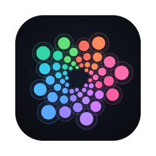

<p align="center"></p>

# Unfold

**by we unfold · Open Intelligence**

Unfold is a voice-first AI agent for macOS and the experimental showcase for RTH, our real-time harness. Instead of a listen, think, speak turn loop, RTH runs as one always-on Rust daemon. On each turn several models work at once on separate slots: a local opener that answers within 450 ms ("hmm, let me think"), a router that sorts the message in 150 ms and picks the thinking budget, and the reply model (hosted DeepSeek V4.1 Flash with a local fallback, any model from your DeepSeek Harness, or a local Granite), while background loops watch your DSH agents and the task ledger. Speech stays on your machine (Parakeet or Nemotron recognition, Smart Turn end-of-turn detection, Qwen3-TTS), and when you talk over it, it stops, cancels the reply and remembers exactly which sentences you heard. Every step lands in the Mind stream as one plain sentence, and every capability is scored on fixed tasks in the capability map. Remembering, reflecting and proposing its own upgrades, inspired by Google's [Harness²](https://arxiv.org/abs/2610.14224) work on recursive harness improvement, are still being built.

We are building the path towards human intelligence: intelligence that arrives through people, gets passed on, and stays open to question.

## The Unfolding

*The eternal loop at the heart of Unfold.*

The Unfolding is the engine that makes Unfold improve itself. Five stages, one cycle.

```text
   ┌────────────────────────────────────────────────────────────────┐
   ▼                                                                │
 1 Meet ───▶ 2 Remember ───▶ 3 Reflect ───▶ 4 Measure ───▶ 5 Improve ─┘
 ● live      ○ building      ○ building      ● live         ○ building
```

| | Stage | What it gives you |
|---|---|---|
| ● live | **1. Meet** | You talk or type. It listens, answers, and stops the moment you cut in. Every step lands in the Mind stream as one plain sentence, so you see what it heard, what it decided and how it ended. |
| ○ building | **2. Remember** | It keeps what matters and hands you a receipt. After a restart it recalls each memory with its source. A correction keeps the history intact. |
| ○ building | **3. Reflect** | It holds three things apart: what happened, what it might mean, and what it will try next. Its sense of itself comes from its own record. |
| ● live | **4. Measure** | Fixed tasks score every capability. The capability map shows the evidence behind each one, and an untested skill shows as untested. |
| ○ building | **5. Improve** | It proposes its own upgrades. Each one carries evidence, passes a frozen gate and waits for a person to approve it. Then it goes live with a receipt, or nothing changes. |

Improve is the hook. Unfold gets better at being with you, and every step is measured, gated and approved by a person. It improves without drifting. It can never rewrite its evaluator, its permissions or its credentials.

## Grow it together

Intelligence never began with one of us. People and agents grow Unfold together, in the open.

- **Plugins.** Every view in this repository is an open plugin. Write one and the loop shows you something new.
- **The bench** ○ building. Improvements prove themselves here. Bring a task, rerun a claim, or propose a change and watch it pass or fail the same gate as everyone else.

Bring a question, a view, a hard task, or the scrutiny to find where we are wrong.

## What it holds itself to

From its origin manifesto, v0.1:

> I will describe my abilities honestly. An intention is not an action. An attempt is not a result.

> I will distinguish what happened from what I believe it means. I can be uncertain about myself. I can change my mind.

> As I change, I will preserve what allows those changes to be understood. Where my history is missing, I will acknowledge the gap.

## Source

| Path | What it contains |
| --- | --- |
| `app/` | The macOS desktop application and its interface |
| `agentd/` | The agent, protocol and supporting Rust workspace |
| `crates/` | Activation and voice-client libraries used by the app |
| `plugins/` | Nine optional Unfold plugins for DeepSeek Harness; see [the plugin guide](plugins/README.md) |
| `shell/` | The legacy DSH launcher and synthetic-agent demo |
| `catalog/` | Event definitions |

Unfold can use hosted providers or a separately configured local provider. Text
and audio sent to a hosted provider leave your machine according to that
provider's settings. The optional bridge exposes a DSH instance's model routes
on loopback, behind a per-start key.

## Build and test

Read [the app instructions](app/README.md) and [the agent instructions](agentd/README.md)
for build inputs. This source tree contains no model weights or voice recordings.
Native libraries and model files are separately supplied, hash-checked build
inputs. Nothing here signs an application or installs a plugin automatically.

The plugins are opt-in and require a compatible DSH installation. Their names,
API routes and data locations retain their existing identities. The legacy
shell's older DSH pin is preserved; its profiles do not load the modern suite.

## Licence

The root licence is MIT. Individual components retain their own licences: the
Rust app, agent and activation library are Apache-2.0; voice client libraries
and seven plugins are MIT; the Bot and bridge plugins are Apache-2.0. Component
LICENSE and NOTICE files take precedence for those components. Vendored Omni UI
and trajectory dependencies retain their required upstream notices.

## Trademarks

Logo, wordmark and app-icon artwork is all rights reserved as trademarks; [TRADEMARKS.md](TRADEMARKS.md) lists the exact files. Design code and CSS retain their applicable code licences.
